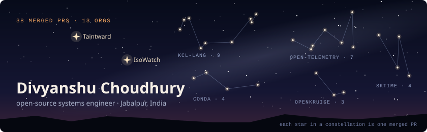
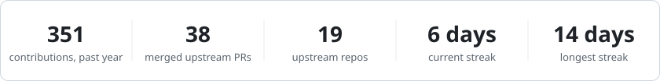
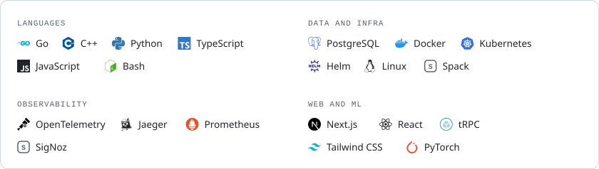

I work on observability, databases and build tooling.

- **GSoC 2026 at INCF / EBRAINS.** Built Spack subset environments for the EBRAINS Software Distribution and got arbor, NEST and NEURON running on EESSI ([merge request](https://gitlab.ebrains.eu/ri/tech-hub/platform/esd/ebrains-spack-builds/-/merge_requests/802)).
- **Recently built** [Taintward](https://github.com/DCchoudhury15/Taintward), which finds emails, SSNs and API keys in an AI agent's tool and model calls and rewrites them before they leave, and [IsoWatch](https://github.com/DCchoudhury15/isowatch), which catches lost updates and write skew in live PostgreSQL traffic.
- Final-year B.Tech CSE student, graduating July 2027.

[Website](https://divyanshuchoudhury.vercel.app) · [LinkedIn](https://www.linkedin.com/in/divyanshu-choudhury) · [X](https://x.com/Divyanscpu15) · [Email](mailto:divyanshuchoudhury51@gmail.com)

<picture>
  <source media="(prefers-color-scheme: dark)" srcset="assets/stats-dark.svg">
  
</picture>

<picture>
  <source media="(prefers-color-scheme: dark)" srcset="assets/upstream-dark.svg">
  
</picture>

<picture>
  <source media="(prefers-color-scheme: dark)" srcset="assets/stack-dark.svg">
  
</picture>

<!-- Cards in assets/ are made by scripts/build.py and refreshed daily by .github/workflows/refresh.yml -->
