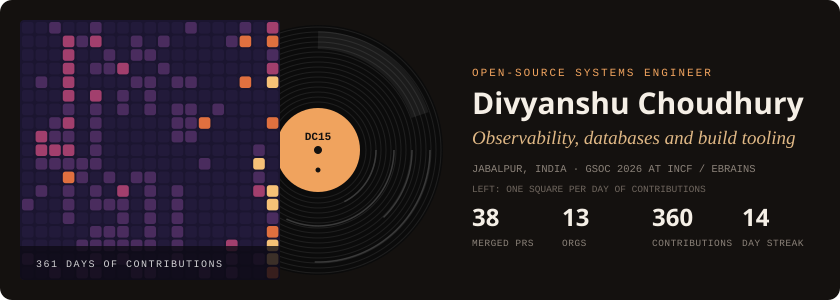
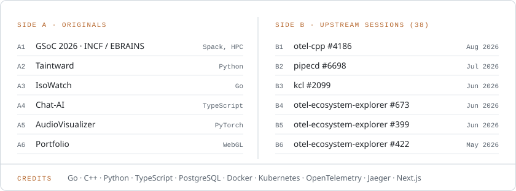
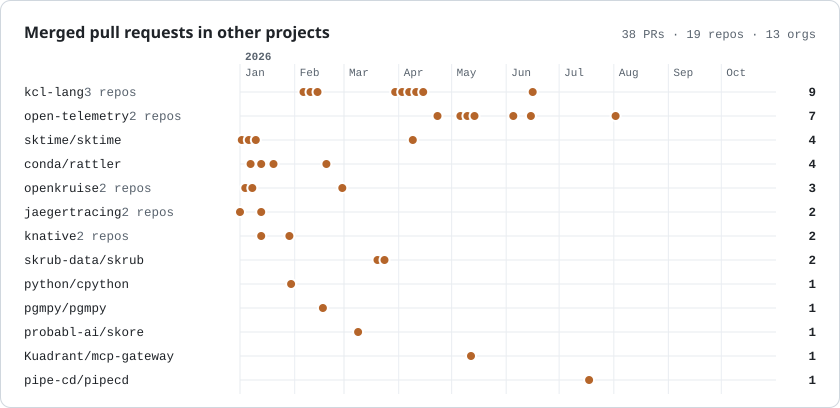

**Liner notes.** I work on observability, databases and build tooling. In GSoC 2026 at INCF / EBRAINS I built Spack subset environments for the EBRAINS Software Distribution and got arbor, NEST and NEURON running on EESSI ([merge request](https://gitlab.ebrains.eu/ri/tech-hub/platform/esd/ebrains-spack-builds/-/merge_requests/802)). Lately I built [Taintward](https://github.com/DCchoudhury15/Taintward) and [IsoWatch](https://github.com/DCchoudhury15/isowatch). Final-year B.Tech CSE, graduating July 2027.

<picture>
  <source media="(prefers-color-scheme: dark)" srcset="assets/tracklist-dark.svg">
  
</picture>

<a href="https://dcchoudhury15.github.io/DCchoudhury15/">
<picture>
  <source media="(prefers-color-scheme: dark)" srcset="assets/upstream-dark.svg">
  
</picture>
</a>

Click the graph for the interactive version: hover a dot to see the PR, click to open it.

<!-- Cards in assets/ are made by scripts/build.py and refreshed daily by .github/workflows/refresh.yml -->
