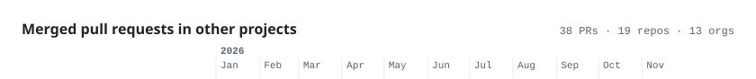

**Liner notes.** I work on observability, databases and build tooling. In GSoC 2026 at INCF / EBRAINS I built Spack subset environments for the EBRAINS Software Distribution and got arbor, NEST and NEURON running on EESSI ([merge request](https://gitlab.ebrains.eu/ri/tech-hub/platform/esd/ebrains-spack-builds/-/merge_requests/802)). Lately I built [Taintward](https://github.com/DCchoudhury15/Taintward) and [IsoWatch](https://github.com/DCchoudhury15/isowatch). Final-year B.Tech CSE, graduating July 2027.

<!-- timeline:start -->
<picture><source media="(prefers-color-scheme: dark)" srcset="assets/upstream/head-dark.svg"></picture>
<a href="https://github.com/search?q=is%3Apr+is%3Amerged+author%3ADCchoudhury15+org%3Akcl-lang&amp;type=pullrequests"><picture><source media="(prefers-color-scheme: dark)" srcset="assets/upstream/kcl-lang-dark.svg"></picture></a>
<a href="https://github.com/search?q=is%3Apr+is%3Amerged+author%3ADCchoudhury15+org%3Aopen-telemetry&amp;type=pullrequests"><picture><source media="(prefers-color-scheme: dark)" srcset="assets/upstream/open-telemetry-dark.svg"></picture></a>
<a href="https://github.com/sktime/sktime/pulls?q=is%3Apr+is%3Amerged+author%3ADCchoudhury15"><picture><source media="(prefers-color-scheme: dark)" srcset="assets/upstream/sktime-dark.svg"></picture></a>
<a href="https://github.com/conda/rattler/pulls?q=is%3Apr+is%3Amerged+author%3ADCchoudhury15"><picture><source media="(prefers-color-scheme: dark)" srcset="assets/upstream/conda-dark.svg"></picture></a>
<a href="https://github.com/search?q=is%3Apr+is%3Amerged+author%3ADCchoudhury15+org%3Aopenkruise&amp;type=pullrequests"><picture><source media="(prefers-color-scheme: dark)" srcset="assets/upstream/openkruise-dark.svg"></picture></a>
<a href="https://github.com/search?q=is%3Apr+is%3Amerged+author%3ADCchoudhury15+org%3Ajaegertracing&amp;type=pullrequests"><picture><source media="(prefers-color-scheme: dark)" srcset="assets/upstream/jaegertracing-dark.svg"></picture></a>
<a href="https://github.com/search?q=is%3Apr+is%3Amerged+author%3ADCchoudhury15+org%3Aknative&amp;type=pullrequests"><picture><source media="(prefers-color-scheme: dark)" srcset="assets/upstream/knative-dark.svg"></picture></a>
<a href="https://github.com/skrub-data/skrub/pulls?q=is%3Apr+is%3Amerged+author%3ADCchoudhury15"><picture><source media="(prefers-color-scheme: dark)" srcset="assets/upstream/skrub-data-dark.svg"></picture></a>
<a href="https://github.com/python/cpython/pulls?q=is%3Apr+is%3Amerged+author%3ADCchoudhury15"><picture><source media="(prefers-color-scheme: dark)" srcset="assets/upstream/python-dark.svg"></picture></a>
<a href="https://github.com/pgmpy/pgmpy/pulls?q=is%3Apr+is%3Amerged+author%3ADCchoudhury15"><picture><source media="(prefers-color-scheme: dark)" srcset="assets/upstream/pgmpy-dark.svg"></picture></a>
<a href="https://github.com/probabl-ai/skore/pulls?q=is%3Apr+is%3Amerged+author%3ADCchoudhury15"><picture><source media="(prefers-color-scheme: dark)" srcset="assets/upstream/probabl-ai-dark.svg"></picture></a>
<a href="https://github.com/Kuadrant/mcp-gateway/pulls?q=is%3Apr+is%3Amerged+author%3ADCchoudhury15"><picture><source media="(prefers-color-scheme: dark)" srcset="assets/upstream/Kuadrant-dark.svg"></picture></a>
<a href="https://github.com/pipe-cd/pipecd/pulls?q=is%3Apr+is%3Amerged+author%3ADCchoudhury15"><picture><source media="(prefers-color-scheme: dark)" srcset="assets/upstream/pipe-cd-dark.svg"></picture></a>
<!-- timeline:end -->

Click an org to see its PRs on GitHub. There is also an <a href="https://dcchoudhury15.github.io/DCchoudhury15/">interactive version</a> where every dot is a link.

<!-- Cards in assets/ are made by scripts/build.py and refreshed daily by .github/workflows/refresh.yml -->
